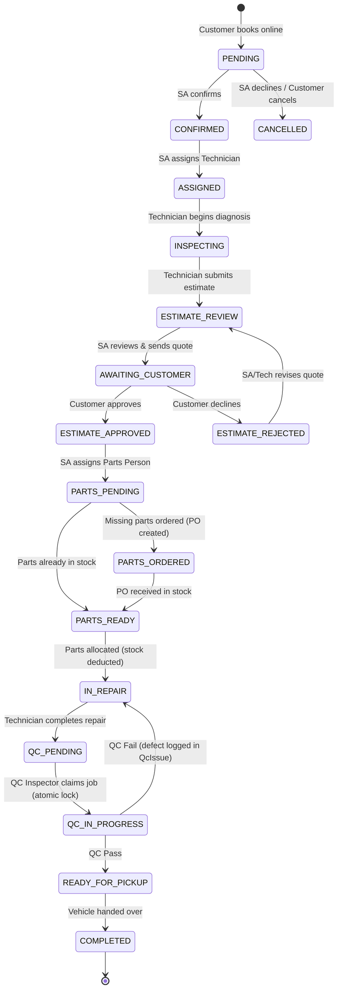

# BayFlow — Multi-Tenant Auto Repair Shop Management Platform

> **Hackathon Version 1.1 — October 2026**  
> Complete implementation of the multi-tenant automotive repair platform, featuring customer online booking, state-machine driven role-based POS, WebRTC in-app voice calling, and an AI Front Desk voice agent.

---

## 🚀 Live Demo & Quick Start

### Seeded Demo Accounts (1-Click Switcher available on all pages)
All demo accounts use password: `password123`

| Role | Name | Email | Password | Primary Responsibilities |
| :--- | :--- | :--- | :--- | :--- |
| **Owner** | Mrs. Fatima Raza | `fatima@lahoreauto.pk` | `password123` | Multi-shop switcher, team management, service catalog, consolidated revenue analytics |
| **Service Advisor (SA)** | Bilal Khan | `bilal@lahoreauto.pk` | `password123` | Confirm bookings, assign technicians, revise estimates, assign parts person, notify pickup |
| **Technician** | Imran Malik | `imran@lahoreauto.pk` | `password123` | Inspect vehicle, build itemized parts & labor estimate, perform repair, resolve QC issues |
| **QC Inspector** | Sara Ahmed | `sara@lahoreauto.pk` | `password123` | Shared QC queue, lock inspection, run checklist, pass or report defect (QC fail loop) |
| **Parts Person** | Usman Tariq | `usman@lahoreauto.pk` | `password123` | Stock catalog, inventory shortage detection, purchase orders, receipt & allocation |
| **Customer** | Ahmed Khan | `ahmed@mail.com` | `password123` | Browse shops, 5-step booking wizard, live timeline, estimate approval, WebRTC calling |

*Additional seeded shops:* **Karachi Motor Works** (`tariq@karachimotor.pk`) and **Islamabad Precision Auto** (`omer@isbauto.pk`).

---

## 🛠️ Tech Stack & Architecture

- **Frontend**: React 18, Vite, TypeScript, Tailwind CSS, Lucide Icons, React Router 6, Axios
- **Backend**: Node.js 24, Express, TypeScript, WebSocket (`ws`) for live notifications & call signaling
- **Database & ORM**: SQLite (zero-config local embedded) / PostgreSQL (switchable via `DATABASE_URL`), Prisma ORM
- **Authentication**: JWT token-based authentication with bcrypt password hashing
- **Security & Multi-Tenancy**: Shop ID scoped queries, strict server-side tenant isolation (`requireTenant`), role-guarded endpoints (`requireShopRole`)
- **Bonus Tracks**:
  - **In-App Calling**: Browser-to-browser WebRTC audio calling with call log persistence
  - **AI Front Desk Voice Agent**: Intelligent virtual receptionist with database lookup tool execution, Web Speech API synthesis, and automated Service Advisor task generation

---

## 📋 Prerequisites

- **Node.js**: `v20+` or `v24+` (Installed: Node 24.14.0)
- **npm**: `v10+` or `v11+`
- **Git**

---

## ⚙️ Installation & Setup

### 1. Clone & Install Dependencies

```bash
# Clone the repository
git clone https://github.com/your-username/bayflow.git
cd bayflow

# Install backend dependencies
cd backend
npm install

# Install frontend dependencies
cd ../frontend
npm install
cd ..
```

### 2. Environment Configuration

Copy `.env.example` to `backend/.env`:

```bash
# On Windows PowerShell
cp .env.example backend/.env
```

#### Environment Variables Explained:
- `PORT`: Backend API port (Default: `4000`)
- `CLIENT_URL`: Allowed frontend origin for CORS (Default: `http://localhost:3000`)
- `DATABASE_URL`: Prisma connection string (Default: `file:./dev.db` for zero-setup SQLite; supports `postgresql://...`)
- `JWT_SECRET`: Secret key for signing and verifying JSON Web Tokens
- `JWT_EXPIRES_IN`: JWT expiration timeframe (e.g., `7d`)

### 3. Database Migration & Seeding

```bash
cd backend

# Synchronize database schema
npx prisma db push

# Seed 3 shops, all team roles, inventory, services, and the worked example
npm run db:seed
```

### 4. Run Automated End-to-End State Machine Tests

```bash
# Runs full worked example verification test (16 lifecycle steps + QC fail loop + AI front desk)
npm run test
```

### 5. Start Development Servers

Run backend and frontend concurrently in two terminals:

```bash
# Terminal 1 (Backend API & WebSocket server on http://localhost:4000)
cd backend
npm run dev

# Terminal 2 (Frontend web app on http://localhost:3000)
cd frontend
npm run dev
```

Visit **`http://localhost:3000`** in your browser.

---

## 🔄 Booking Lifecycle & State Machine



### Key Edge Cases Enforced:
1. **Estimate Revision Tracking**: When the Service Advisor adjusts labour charges or discount, the estimate's `revision` count increments to maintain a transparent audit history.
2. **QC Fail Loop**: A failed QC creates a structured `QcIssue` record and returns the vehicle to `IN_REPAIR` for the assigned technician. It can repeat until the inspector passes the vehicle.
3. **Inventory Shortage & PO Receiving**: Parts Person view highlights parts shortages against real on-hand stock. Receiving a Purchase Order increments stock and auto-evaluates if the job is ready.
4. **Cancellation Stock Safety**: If a booking is cancelled prior to `IN_REPAIR`, any reserved parts are automatically returned to inventory stock.
5. **Atomic Slot Capacity**: Prevents double-booking by validating existing bookings against the shop's slot capacity atomically.
6. **Strict Multi-Tenancy**: A staff member belonging to Shop A attempting to access Shop B receives HTTP `403 Forbidden`.

---

## 🌟 Bonus Features

### 1. In-App WebRTC Calling (Section 8.1)
- Direct voice calling button on the booking card for both Service Advisor and Customer.
- Full call state handling: `RINGING`, `CONNECTED`, `ENDED`, `MISSED`.
- Call records saved against the booking with caller, duration, timestamp, and status.

### 2. AI Front Desk Voice Receptionist (Section 8.2)
- Interactive virtual assistant answering customer inquiries about vehicles.
- Database tool execution: answers questions like *"What is the status of my Honda Civic LEA-1234?"* or *"How much is my estimate?"*.
- Real-time speech synthesis (Web Speech API).
- Automatically summarizes customer intent and creates an actionable task in the Service Advisor's dashboard with a `Mark Done` toggle.

### 3. Additional Features (Section 8.3)
- **Itemized Tax Invoices**: Printable / PDF-style repair receipts with breakdown of parts, labor, subtotal, and shop header.
- **Public Vehicle Maintenance History**: Lookup past service records by license plate (e.g. `LEA-1234`).
- **Owner Multi-Shop Analytics**: Cross-shop revenue, active repairs, and QC failure rate metrics.

---

## 📁 Repository Structure

```
BYFLOW/
├── backend/
│   ├── prisma/
│   │   ├── schema.prisma       # Prisma data models & relations
│   │   ├── seed.ts             # Comprehensive database seed script
│   │   └── dev.db              # SQLite embedded database
│   ├── src/
│   │   ├── middleware/
│   │   │   └── auth.ts         # JWT & Tenant isolation middleware
│   │   ├── routes/
│   │   │   ├── authRoutes.ts   # Auth & demo switch endpoints
│   │   │   ├── bookingRoutes.ts# Bookings & state machine transitions
│   │   │   ├── shopRoutes.ts   # Shops, members & services
│   │   │   ├── estimateRoutes.ts
│   │   │   ├── inventoryRoutes.ts
│   │   │   ├── qcRoutes.ts
│   │   │   ├── callRoutes.ts   # In-app calls & AI Front Desk
│   │   │   └── analyticsRoutes.ts
│   │   ├── services/
│   │   │   ├── stateMachine.ts # Booking state engine & transition rules
│   │   │   ├── aiFrontDeskService.ts
│   │   │   └── notificationService.ts
│   │   ├── types/
│   │   └── server.ts           # Express & WebSocket server
│   └── test/
│       └── api.test.ts         # 16-step lifecycle & QC loop automated test
├── frontend/
│   ├── src/
│   │   ├── components/
│   │   │   ├── layout/         # Navbar, DemoSwitcherBar
│   │   │   ├── pos/            # Role-based views: SA, Tech, Parts, QC, Owner
│   │   │   ├── calling/        # In-App CallModal, AIFrontDeskModal
│   │   │   └── invoice/        # Printable Tax Invoice Modal
│   │   ├── context/
│   │   │   └── AuthContext.tsx # Central auth & WebSocket state
│   │   ├── pages/
│   │   │   ├── LandingPage.tsx
│   │   │   ├── BookingWizard.tsx
│   │   │   ├── CustomerDashboard.tsx
│   │   │   ├── ShopPOS.tsx
│   │   │   ├── LoginPage.tsx
│   │   │   └── RegisterOwnerPage.tsx
│   │   └── App.tsx
├── .env.example
├── README.md
└── package.json
```
