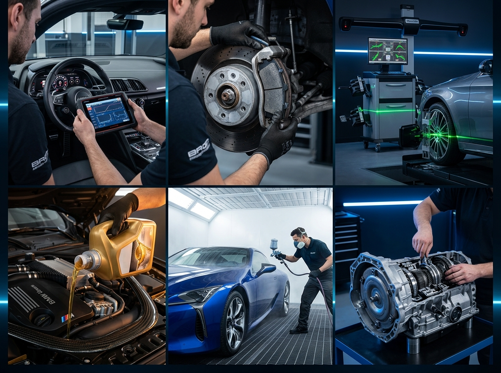
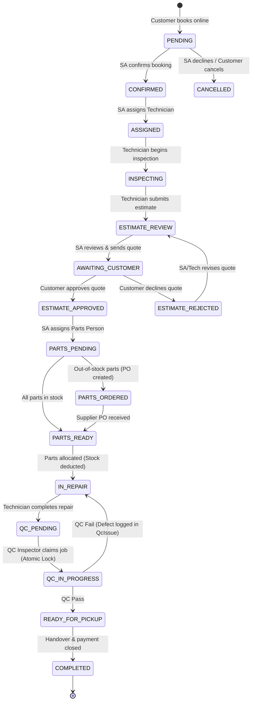

# 🚗 BayFlow — Multi-Tenant Automotive SaaS Platform

<div align="center">


### Enterprise Multi-Tenant Auto Repair Management, Real-Time State Machine, WebRTC Voice Calling & AI Front Desk

[](https://www.typescriptlang.org/)
[](https://reactjs.org/)
[](https://vitejs.dev/)
[](https://nodejs.org/)
[](https://expressjs.com/)
[](https://www.prisma.io/)
[](https://tailwindcss.com/)
[](https://webrtc.org/)
[](LICENSE)

**BayFlow** is a next-generation, multi-tenant automotive SaaS platform designed for independent workshop chains, service franchises, and car owners. It provides strict tenant isolation, a deterministic 8-stage repair state machine, digital estimate authorization, ERP parts inventory control, WebRTC in-app voice calling, and an AI-driven Voice Front Desk receptionist.

---

</div>

## 📑 Table of Contents

1. [Key Features & Capabilities](#-key-features--capabilities)
2. [Platform Architecture](#-platform-architecture)
3. [Seeded Demo Accounts (1-Click Switcher)](#-seeded-demo-accounts-1-click-switcher)
4. [Screens & Workflow Walkthrough](#-screens--workflow-walkthrough)
   - [1. Public Marketplace & Garage Directory (`/`)](#1-public-marketplace--garage-directory-)
   - [2. 5-Step Online Booking Wizard (`/book`)](#2-5-step-online-booking-wizard-book)
   - [3. Customer Telemetry & Repair Tracker (`/portal`)](#3-customer-telemetry--repair-tracker-portal)
   - [4. Shop POS: Role-Based Workshop Consoles (`/pos`)](#4-shop-pos-role-based-workshop-consoles-pos)
     - [Shop Owner Console](#shop-owner-console)
     - [Service Advisor (SA) Terminal](#service-advisor-sa-terminal)
     - [Technician Workshop Terminal](#technician-workshop-terminal)
     - [Parts & Inventory (ERP) Counter](#parts--inventory-erp-counter)
     - [Quality Control (QC) Inspector Portal](#quality-control-qc-inspector-portal)
   - [5. AI Voice Front Desk Receptionist](#5-ai-voice-front-desk-receptionist)
   - [6. In-App WebRTC Voice Calling](#6-in-app-webrtc-voice-calling)
   - [7. Printable Itemized Tax Invoice](#7-printable-itemized-tax-invoice)
5. [Deterministic State Machine Workflow](#-deterministic-state-machine-workflow)
6. [Prerequisites & System Requirements](#-prerequisites--system-requirements)
7. [Local Installation & Quick Start](#-local-installation--quick-start)
8. [Automated End-to-End State Machine Tests](#-automated-end-to-end-state-machine-tests)
9. [Deployment Guide (Vercel + Free Backend)](#-deployment-guide-vercel--free-backend)
10. [REST API Documentation](#-rest-api-documentation)
11. [Multi-Tenancy & Security Isolation](#-multi-tenancy--security-isolation)

---

## ⚡ Key Features & Capabilities

- **Strict Multi-Tenant Isolation**: Complete database and business logic boundary across workshops (`x-shop-id` scoped middleware). Zero data leakage across competing garages.
- **8-Stage Repair State Machine**: Enforces transparent digital estimate approval before any physical repair or parts allocation begins.
- **Role-Based Workstations**: Dedicated specialized UI views tailored for **Shop Owner**, **Service Advisor**, **Technician**, **Parts Person**, **QC Inspector**, and **Customer**.
- **Real-Time ERP Inventory Engine**: Automatic parts shortage detection, supplier Purchase Orders (PO), receiving workflows, and immediate stock allocation.
- **QC Defect Rework Loop**: Atomic inspection queue locking prevents multi-inspector race conditions; defects trigger automated rework loops for technicians.
- **In-App WebRTC Audio Calling**: Direct browser-to-browser voice link between car owners and service advisors with persistent call logging.
- **AI Voice Front Desk**: Interactive virtual receptionist powered by speech synthesis that queries vehicle repair status via database tool execution and logs follow-up tasks for advisors.
- **Automated WhatsApp Integration**: Instant one-click pre-filled WhatsApp messaging with Pakistani mobile normalization (`923...`).
- **Mobile-Responsive Design**: Tailored layouts across all screens, dropdown switchers for compact viewports, and zero horizontal overflow.

---

## 🏗️ Platform Architecture

```
                           ┌────────────────────────────────────────┐
                           │      Client Layer (Vite + React 18)    │
                           │  - Public Portal & Booking Wizard      │
                           │  - Role-Based Shop POS Terminals       │
                           │  - WebRTC Audio & Speech Synthesis     │
                           └──────────────────┬─────────────────────┘
                                              │ HTTP / JSON & WSS
                                              ▼
                           ┌────────────────────────────────────────┐
                           │      Backend API (Node.js + Express)   │
                           │  - Multi-Tenant Scoping Middleware     │
                           │  - JWT Authentication & RBAC Guard     │
                           │  - State Machine Workflow Engine       │
                           │  - Real-Time WebSocket Event Broker    │
                           └──────────────────┬─────────────────────┘
                                              │ Prisma ORM
                                              ▼
                           ┌────────────────────────────────────────┐
                           │      Database Layer (SQLite / LibSQL)  │
                           │  - Shops, Users, Memberships           │
                           │  - Bookings, Estimates, Line Items     │
                           │  - Inventory SKUs, Purchase Orders     │
                           │  - QC Issues, Call Logs, AI Tasks      │
                           └────────────────────────────────────────┘
```

---

## 🔑 Seeded Demo Accounts (1-Click Switcher)

BayFlow features an integrated **Demo Switcher Bar** atop every screen. You can switch personas instantly with one click:

| Role | Name | Email | Password | Primary Capabilities |
| :--- | :--- | :--- | :--- | :--- |
| **👑 Shop Owner** | Mrs. Fatima Raza | `fatima@lahoreauto.pk` | `password123` | Multi-shop switcher, consolidated P&L revenue, staff permissions, catalog pricing |
| **📋 Service Advisor** | Bilal Khan | `bilal@lahoreauto.pk` | `password123` | Appointment triage, technician assignment, estimate review, customer quote dispatch |
| **🔧 Technician** | Imran Malik | `imran@lahoreauto.pk` | `password123` | Diagnostic check, estimate builder, physical repair, QC rework resolution |
| **📦 Parts Person** | Usman Tariq | `usman@lahoreauto.pk` | `password123` | Inventory catalog, parts shortage detection, supplier PO creation & receiving |
| **🔍 QC Inspector** | Sara Ahmed | `sara@lahoreauto.pk` | `password123` | Shared QC queue, atomic lock, 8-point checklist pass, or structured defect fail loop |
| **🚗 Vehicle Owner** | Ahmed Khan | `ahmed@mail.com` | `password123` | Online booking, live repair telemetry, digital estimate approval, WebRTC calling |

*Multi-Tenant Workshop Seed Data:*
- **Lahore Auto Care** (Lahore, Punjab)
- **Karachi Motor Works** (Karachi, Sindh)
- **Islamabad Precision Auto** (Islamabad Capital Territory)
- **MZ Autos** (Multan, Punjab)

---

## 🖥️ Screens & Workflow Walkthrough

### 1. Public Marketplace & Garage Directory (`/`)

The storefront introduces car owners to certified workshops in their city.



- **Hero & Value Proposition**: Displays tenant protection guarantees, certified mechanics, and zero-counterfeit parts policies.
- **Public Vehicle Maintenance History Check**: Any user can enter a registration plate (e.g. `LEA-1234`) to review authenticated maintenance history, mileage logs, and completed services without logging in.
- **Verified Garages Directory**: Interactive filterable workshop cards showing city, address, rating, available bays, and one-click direct booking.
- **Quick Service Catalog**: Transparent pricing for Routine Service, Engine Tuning, Brake Overhaul, AC Diagnostics, Suspension Overhaul, and Multi-Point Inspection.

---

### 2. 5-Step Online Booking Wizard (`/book`)

A frictionless, step-by-step booking pipeline that prevents double-booking via atomic slot verification.


1. **Step 1 — Select Workshop**: Choose from verified shops with ratings and bay capacity.
2. **Step 2 — Vehicle Credentials**: Enter Year, Make, Model, License Plate (`LEA-1234`), Color, and current Mileage.
3. **Step 3 — Service Package**: Choose one or multiple service packages with itemized base costs.
4. **Step 4 — Atomic Slot Booking**: Choose service date and time slot. Backend validates existing bookings against shop bay capacity to prevent double-booking.
5. **Step 5 — Review & Confirmation**: Generates a permanent booking reference (`#REF-XXXX`) and notifies the workshop in real-time.

---

### 3. Customer Telemetry & Repair Tracker (`/portal`)

The customer tracking portal is the central communication hub between the vehicle owner and the repair workshop.


- **Live 8-Stage Progress Tracker**: Visual progress bar tracking stages: `Booking Placed` → `Confirmed` → `Diagnostic Check` → `Estimate Review` → `In Repair` → `Quality Control` → `Ready for Pickup` → `Completed`.
- **Digital Estimate Review**:
  - Detailed breakdown of parts and workshop labor.
  - One-click **"Digitally Approve Quote"** triggers parts allocation and authorizes repair.
  - **"Decline / Request Price Revision"** sends user feedback back to the Service Advisor.
- **In-App WebRTC Calling**: One-click audio link to the assigned Service Advisor.
- **Direct WhatsApp Chat**: One-click WhatsApp link pre-filled with customer reference and vehicle details.
- **Official Tax Invoice**: View and print itemized bills with shop header, tax registration, and payment status.

---

### 4. Shop POS: Role-Based Workshop Consoles (`/pos`)

When workshop staff log into the POS, the system automatically opens their specialized interface based on their role.

#### Shop Owner Console
- **Multi-Screen Switcher**: Allows the owner to inspect any department console (`Service Advisor`, `Technician`, `Parts Counter`, `QC Portal`).
- **Revenue Analytics**: Live gross revenue, labor earnings, parts turnover, and pending receivables.
- **Staff Roster Management**: Add new technicians, assign roles, and view active shifts.
- **Service Catalog Customizer**: Add or update standard labor rates and shop services.

#### Service Advisor (SA) Terminal
- **New Bookings Triage**: Confirm or reject incoming customer appointments.
- **Technician Assignment**: Allocate specific technicians to vehicles.
- **Estimate Review & Markup**: Review technician diagnostics, adjust labor charges or discounts, and send quotes to customers.
- **Customer Notifications**: Send pickup alerts via SMS/WhatsApp when QC passes.

#### Technician Workshop Terminal
- **Diagnostic Inspection**: Start physical diagnostics on assigned cars.
- **Parts & Labor Estimate Builder**: Real-time part search against inventory with pricing and availability badges.
- **Parts Readiness Indicator**: Displays `✓ ALL PARTS IN STOCK` when parts are ready; enables the **"Start Repair Now"** action.
- **QC Defect Resolution**: View specific failed checklist items reported by QC inspectors, perform rework, and resubmit to QC queue.

#### Parts & Inventory (ERP) Counter
- **Work Orders Awaiting Parts**: Detects jobs that require parts with instant shortage flags.
- **Purchase Order (PO) Management**: Generate purchase orders to external suppliers for out-of-stock components.
- **PO Receiving & Auto-Resolution**: When a delivery arrives, receiving the PO automatically increments inventory and marks awaiting work orders as **Ready to Allocate**.
- **Inventory Catalog**: Real-time stock levels, SKU tracking, reorder alert thresholds, and cost/sell price margins.

#### Quality Control (QC) Inspector Portal
- **Atomic Lock Queue**: Inspectors claim cars for testing; atomic locking prevents collisions between multiple inspectors.
- **Comprehensive 8-Point Checklist**:
  1. Engine Idle & Operating Temperature
  2. Brake Pedal Pressure & Stopping Distance
  3. Fluid Levels (Oil, Coolant, Brake Fluid)
  4. Electrical Systems, Battery & Diagnostic Codes
  5. Suspension, Steering Play & Alignment
  6. Road Test Completed Under Normal Load
  7. Dashboard Warning Lights Extinguished
  8. Interior Cleanliness & Tool Clearance
- **Pass or Fail Workflow**:
  - **Pass**: Advances booking to `READY_FOR_PICKUP` and alerts the Service Advisor.
  - **Fail**: Logs structured defect notes into `QcIssue` and routes the car back to `IN_REPAIR` for rework.

---

### 5. AI Voice Front Desk Receptionist

Accessible from the navbar and customer portal, the AI Front Desk handles inquiries 24/7.

- **Natural Speech Interaction**: Speaks and listens using the browser's Web Speech API.
- **Database Tool Execution**:
  - *Lookup Vehicle Status*: Ask *"What is the status of car LEA-1234?"* to receive real-time stage updates.
  - *Estimate Quotes*: Inquire about repair costs and parts pricing.
  - *Service Inquiries*: Inquire about oil changes, brake pads, and opening hours.
- **Service Advisor Task Creation**: Automatically summarizes customer requests and places an actionable task on the Service Advisor's board.

---

### 6. In-App WebRTC Voice Calling

- **Real-Time Voice Link**: High-fidelity browser-to-browser WebRTC audio between car owner and workshop advisor.
- **WebSocket Signaling**: Handles SDP offer, answer, and ICE candidate exchange via the backend WebSocket server (`/ws`).
- **Full Call State Machine**: Ringing modal, audio stream connect, microphone mute, call timer, and hang up.
- **Call History Logging**: Saves call duration, caller identity, and timestamps directly to the booking's audit log.

---

### 7. Printable Itemized Tax Invoice

- Formatted tax invoice modal accessible by both Customer and Service Advisor.
- Displays shop legal name, tax registration number, booking reference, and vehicle identification.
- Itemized parts catalog with unit costs, quantities, and totals.
- Transparent workshop labor rates, applied discounts, and net total payable.
- Built-in browser print styles for one-click physical receipt printing.

---

## 🔄 Deterministic State Machine Workflow

The entire repair process is governed by a strict state machine implemented in [`backend/src/services/stateMachine.ts`](file:///c:/Users/pakistan/Desktop/BYFLOW/backend/src/services/stateMachine.ts):



### Key Business Rules Enforced:
1. **Estimate Revision Auditing**: Every price modification increments the estimate's `revision` count, preserving full audit history.
2. **Defect Loop**: A QC failure creates a structured `QcIssue` defect record and returns the vehicle to `IN_REPAIR`. Work cannot be approved until all defects are resolved.
3. **Atomic Inventory Allocation**: Stock is reserved and deducted only upon entering `IN_REPAIR`. If a job is cancelled prior to repair, reserved inventory is safely restored.
4. **Capacity Protection**: Prevents double-booking by locking slots against max bay capacity.

---

## 📋 Prerequisites & System Requirements

- **Node.js**: `v20.0.0` or higher (Tested on Node `v24.14.0`)
- **npm**: `v10.0.0` or higher
- **Git**
- **Modern Web Browser**: Chrome, Edge, Firefox, or Safari (supporting WebRTC and Web Speech API)

---

## 🚀 Local Installation & Quick Start

### 1. Clone the Repository
```bash
git clone https://github.com/your-username/bayflow.git
cd bayflow
```

### 2. Install Dependencies
```bash
# Install backend packages
cd backend
npm install

# Install frontend packages
cd ../frontend
npm install
cd ..
```

### 3. Environment Setup
Create a `.env` file inside `backend/`:
```bash
# backend/.env
PORT=4000
NODE_ENV=development
CLIENT_URL=http://localhost:3000
DATABASE_URL="file:./dev.db"
JWT_SECRET="super-secret-bayflow-production-key-2026"
JWT_EXPIRES_IN="7d"
```

### 4. Database Setup & Seeding
```bash
cd backend

# Sync Prisma schema to SQLite
npx prisma db push

# Seed demo shops, vehicles, inventory, and users
npm run db:seed
```

### 5. Launch Development Servers

Open two terminal windows:

**Terminal 1 — Backend API & WebSocket Server:**
```bash
cd backend
npm run dev
# Running on http://localhost:4000 (WebSocket at ws://localhost:4000/ws)
```

**Terminal 2 — Frontend Application:**
```bash
cd frontend
npm run dev
# Running on http://localhost:3000
```

Open your browser at **`http://localhost:3000`** and use the **Demo Switcher Bar** to begin exploring!

---

## 🧪 Automated End-to-End State Machine Tests

The platform includes an automated end-to-end integration test verifying the full 16-step repair lifecycle, the QC defect loop, and AI front desk queries:

```bash
cd backend
npm run test
```

**What the test suite validates:**
- [x] Shop Owner authentication & tenant scoping
- [x] Online booking creation with reference generation
- [x] Service Advisor confirmation & technician assignment
- [x] Technician inspection & itemized estimate creation
- [x] Customer digital estimate approval
- [x] Parts Person inventory check & purchase order flow
- [x] Stock deduction on repair start
- [x] QC inspection atomic lock & defect failure loop
- [x] QC rework completion & final pass
- [x] Pickup notification & job completion
- [x] AI Front Desk vehicle status lookup tool execution

---

## 🌐 Deployment Guide (Vercel + Free Backend)

### Frontend Deployment on Vercel (100% Free)
The frontend is pre-configured with [`frontend/vercel.json`](file:///c:/Users/pakistan/Desktop/BYFLOW/frontend/vercel.json) for Single Page App routing:

1. Push your repository to **GitHub**.
2. Go to **[Vercel](https://vercel.com)** and click **Add New Project**.
3. Import your GitHub repository.
4. Set **Root Directory** to `frontend`.
5. Under **Environment Variables**, add:
   - `VITE_API_URL`: `https://your-backend.onrender.com`
   - `VITE_WS_URL`: `wss://your-backend.onrender.com/ws`
6. Click **Deploy**.

### Backend Deployment on Render.com (100% Free)
1. Sign up at **[Render.com](https://render.com)**.
2. Click **New +** → **Web Service** and connect your GitHub repo.
3. Configure settings:
   - **Root Directory**: `backend`
   - **Build Command**: `npm install && npx prisma generate && npx prisma db push && npm run build`
   - **Start Command**: `node dist/server.js`
   - **Plan**: Free
4. Add environment variables:
   - `PORT`: `4000`
   - `DATABASE_URL`: `file:./prisma/dev.db` (or a free [Turso](https://turso.tech) Cloud SQLite URL)
   - `JWT_SECRET`: `your-secure-production-jwt-secret`
5. Click **Create Web Service**.

---

## 📡 REST API Documentation

### Authentication & Tenant
| Method | Endpoint | Description |
| :--- | :--- | :--- |
| `POST` | `/api/auth/register` | Register new customer or shop owner |
| `POST` | `/api/auth/login` | Sign in with email and password |
| `POST` | `/api/auth/switch-demo`| 1-click demo persona switcher |
| `GET` | `/api/auth/me` | Fetch active user credentials & shop memberships |

### Bookings & Lifecycle
| Method | Endpoint | Description |
| :--- | :--- | :--- |
| `GET` | `/api/bookings` | List bookings (scoped to shop or customer) |
| `POST` | `/api/bookings` | Create new vehicle service appointment |
| `POST` | `/api/bookings/:id/transition` | Execute state machine transition action |
| `GET` | `/api/bookings/public-history` | Public vehicle service history check by license plate |

### Estimates & Billing
| Method | Endpoint | Description |
| :--- | :--- | :--- |
| `GET` | `/api/estimates/:bookingId` | Fetch itemized estimate history for a job |
| `POST` | `/api/estimates/:bookingId` | Submit new estimate or revision with line items |

### Inventory & Procurement (ERP)
| Method | Endpoint | Description |
| :--- | :--- | :--- |
| `GET` | `/api/inventory/:shopId/inventory` | List parts catalog with stock levels |
| `POST` | `/api/inventory/:shopId/inventory` | Add new inventory SKU |
| `GET` | `/api/inventory/:shopId/purchase-orders` | List supplier purchase orders |
| `POST` | `/api/inventory/:shopId/purchase-orders` | Create new purchase order |
| `POST` | `/api/inventory/:shopId/purchase-orders/:id/receive` | Receive delivery & resolve shortages |
| `POST` | `/api/inventory/bookings/:id/allocate-parts` | Deduct stock & transition job to `IN_REPAIR` |

### Quality Control (QC)
| Method | Endpoint | Description |
| :--- | :--- | :--- |
| `GET` | `/api/qc/queue` | List vehicles pending quality control |
| `POST` | `/api/qc/:bookingId/claim` | Atomically lock vehicle for inspection |
| `POST` | `/api/qc/:bookingId/submit` | Submit 8-point checklist (Pass or Fail with defect notes) |

### In-App Calling & AI Front Desk
| Method | Endpoint | Description |
| :--- | :--- | :--- |
| `POST` | `/api/calls/initiate` | Start WebRTC voice call between customer and advisor |
| `POST` | `/api/calls/:id/signal` | Send WebRTC SDP offer/answer/candidate |
| `POST` | `/api/calls/:id/end` | Terminate call and record call duration |
| `POST` | `/api/ai-front-desk/query` | Process virtual receptionist voice prompt with DB tool execution |

---

## 🔒 Multi-Tenancy & Security Isolation

BayFlow implements multi-tenancy at every level:
- **Tenant Middleware Guard**: Every workshop API request is verified through `requireTenant` and `requireShopRole` middleware.
- **Header Scoping**: Requests must supply an `x-shop-id` header matching an authorized membership.
- **Cross-Tenant Prevention**: An authenticated employee of Shop A attempting to read or mutate Shop B data receives HTTP `403 Forbidden`.
- **Private Pricing & Inventory**: Catalogs, stock counts, supplier costs, and labor rates remain private to each individual workshop tenant.

---

## 📄 License

This project is licensed under the MIT License — see the [LICENSE](LICENSE) file for details.

<div align="center">
  <b>BayFlow — The Modern Operating System for Automotive Workshops</b><br>
  Built with ❤️ for multi-tenant automotive excellence.
</div>
